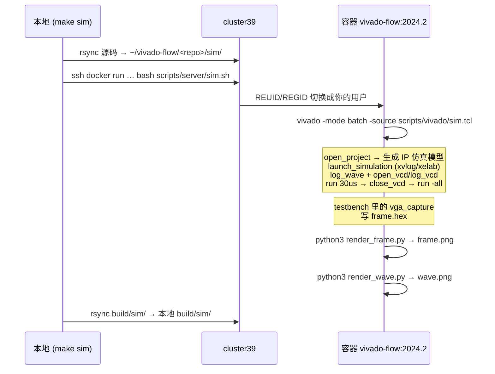

# 3. 服务器 Vivado 仿真与出图

```bash
make sim            # 仿真 + 渲染 → build/sim/
make compare        # 和本地 Verilator 抓到的帧逐像素比较
make wave-gui       # （可选）Vivado GUI 打开 WDB 并截图 → build/sim/vivado_gui.png
MODE=3 make sim     # 换图案
```

## 3.1 整条链路



`build/sim/` 里的文件：

| 文件 | 由谁产生 | 内容 |
| --- | --- | --- |
| `frame.hex` | testbench 中的 `vga_capture` | 一帧 800x600 的像素（RGB332，文本） |
| `frame.png` | `render_frame.py` | 上面那帧的图片 |
| `wave.vcd` | `sim.tcl` 的 `log_vcd` | 开头 30 µs、`/tb_vga_frame/*` 和 `/tb_vga_frame/dut/*` 的波形 |
| `wave.png` | `render_wave.py` | VCD 画成的波形图（默认 0~25 µs，游标在 17.12 µs 的 hsync 上升沿） |
| `tb_vga_frame_behav.wdb` | xsim（`log_wave`） | Vivado 波形数据库，覆盖整个仿真时长，可以用 Vivado GUI 打开 |
| `wave.wcfg`、`vivado_gui.png` | `make wave-gui` | 波形配置和 GUI 截图 |
| `vivado.log`、`compile.log`、`elaborate.log`、`simulate.log` | Vivado | 出错时先看这些 |

## 3.2 仿真数据怎么变成图片（技术选型）

仿真的“数据”有两类，分别用最合适的方式出图。

### 画面：`vga_capture` → `frame.hex` → `frame.png`

[`vga_capture.sv`](../thinpad_top.srcs/sim_1/new/vga_capture.sv) 是挂在 testbench 里的“虚拟显示器”：

- 在 `video_clk` 上升沿采样 `{red, green, blue}`。每一段 `de` 高电平算一行，抓满 600 行就写文件并拉高 `done`。
- 行边界由 `de` 决定，所以不要求计数器从 0 开始。`WAIT_VSYNC=1` 时先等一个 vsync 再开始抓，代价是多仿真一帧。
- 输出是纯文本：第一行 `# vga_capture 800x600 rgb332`，之后每行 800 个两位十六进制数。X/Z 像素会被写成 `xx`。

[`render_frame.py`](../scripts/render_frame.py) 只用 Python 标准库（`zlib` + `struct` 手写 PNG）：

- RGB332 按比例扩展成 RGB888。X/Z 像素画成**品红**，并以退出码 2 结束，出了问题一眼能看到。
- `--diff` 逐像素比较两帧，本仓库用它确认 Verilator 和 xsim 的结果一致。

为什么不从波形里还原画面：一帧有 69 万个时钟周期，全量 VCD 会有几百 MB，Python 解析也慢。
在 testbench 里直接写像素又快又准，而且 xsim 和 Verilator 通用。

### 波形：`log_vcd` → `wave.vcd` → matplotlib → `wave.png`

- [`sim.tcl`](../scripts/vivado/sim.tcl) 用 xsim 的 Tcl 接口写 VCD，**不需要改 testbench**，课程自带的 `lab*_tb` 也能直接用。
  它只把 `VCD_SCOPES` 范围内的线网、寄存器、端口写进去（xsim 里 SV 的 `logic` 类型叫 `reg`），默认只写开头 `VCD_TIME=30us`。
- [`render_wave.py`](../scripts/render_wave.py) 是自带的 VCD 解析器加 matplotlib 绘图，不依赖其他 VCD 库：
  - 单比特信号画阶梯线，总线画成六边形并标注数值，X 用红色、Z 用黄色，变化太密时自动画成色带。
  - `--cursor` 画游标，并在左边列出每个信号在游标处的值，和 Vivado 的 Value 列一样。
  - 同一个脚本也能画 Verilator 的 VCD：信号按层次名**后缀**匹配，`dut.leds` 同时匹配 xsim 的 `tb_vga_frame.dut.leds` 和 Verilator 的 `TOP.tb_vga_frame.dut.leds`。

常用参数：

```bash
python3 scripts/render_wave.py build/sim/wave.vcd --list                 # 看有哪些信号
python3 scripts/render_wave.py build/sim/wave.vcd -o w.png \
    --signals sim/wave_signals.txt --start 15us --end 22us --cursor 17.12us
python3 scripts/render_wave.py build/sim/wave.vcd -o w.png -s 'dut.video_*' --theme light
```

信号清单 [`sim/wave_signals.txt`](../sim/wave_signals.txt) 每行一个模式。可选的第二列写显示名，也可以带 `radix=hex|dec|sdec|bin|ascii`（ascii 用于 testbench 里存字符串的向量）。
`-- 标题` 表示分组。这份清单同时用于 `make wave-gui`。

想在服务器上改出图参数，可以用环境变量透传：

```bash
WAVE_ARGS="--start 16us --end 20us --cursor 17.12us" make sim
VCD_TIME=200us WAVE_ARGS="--end 200us" make sim        # 记录更长的波形
VCD_SCOPES="/tb_vga_frame/dut/pattern/*" WAVE_SIGNALS=my_signals.txt make sim
```

### Vivado 自己画的波形：`make wave-gui`

有时候就是想看 Vivado 波形窗口本身的样子。[`wave_gui.sh`](../scripts/server/wave_gui.sh) 在容器里做这些事：

1. 启动虚拟显示器 `Xvfb :77`，分辨率 1920x1080。
2. `vivado -mode gui -source scripts/vivado/wave_gui.tcl`，在 GUI 里执行：
   - `open_wave_database` 打开 `build/sim/*.wdb`
   - 按 `wave_signals.txt` 调用 `add_wave`（分组用 `add_wave_divider`）
   - `save_wave_config` 保存 `wave.wcfg`，改写里面的缩放范围和游标，再 `open_wave_config` 打开
   - 写一个标记文件
3. 外面的 shell 看到标记后，用 [`xctl.py`](../scripts/server/xctl.py)（ctypes 调 Xlib，不用装 xdotool）把 Vivado 主窗口
   拉到 1920x1080，等 8 秒重新布局，再用 ImageMagick 的 `import -window` 截图，然后关掉 Vivado。

   不拉大的话，Vivado 不管屏幕多大都开成 1500x950，波形窗口只放得下约 20 行，信号多了会被窗口底部的横线从中间截断，
   横线下面那条黑色区域就出现在截图中间。这条黑色区域是 Vivado 波形窗口自带的（课程文档里的 Vivado 截图也有），
   拉大之后它在信号列表下方，不再截断信号。

限制：

- Vivado **没有**缩放波形的 Tcl 命令，只能改 wcfg 里的 `<ZoomEndTime>`。
- Vivado 打开 wcfg 时按一个约 94 px 宽的面板换算缩放，之后面板变宽就显示更长的时间：显示范围 ≈ 面板宽度 / 94 × wcfg 里写的。
  1920x1080 下波形面板约 885 px，实测系数 9.42（原来 1500x950 时是 4.94），脚本按它反向补偿（`ZOOM_FIX`）。
  换分辨率或布局后要重新标定。需要精确时间窗口时，以 `render_wave.py` 的结果为准。
- 截图大约 40 秒，所以不放在 `make sim` 里，需要时单独跑。
- `wave.wcfg` 拉回本地后，也可以在装了 Vivado 的电脑上连同 `.wdb` 一起打开继续看。

## 3.3 sim.tcl 做了什么（以及为什么）

| 步骤 | 说明 |
| --- | --- |
| `open_project thinpad_top.xpr` | 读工程的 `sim_1` fileset，和 GUI 里点 Run Simulation 用的是同一套源文件和设置 |
| 检查 `SIM_TOP` | 工程是自动层次模式，顶层名写错时 Vivado 只报 CRITICAL WARNING，然后悄悄换一个顶层。这里直接报错 |
| `upgrade_ip` / `generate_target simulation` | 新 clone 的工程没有 IP 的仿真模型。GUI 会自动生成，batch 模式不会，缺了就报 `Module <pll_example> not found` |
| `set_property generic` | 把 `GENERICS` 设成仿真顶层的 parameter（对应 GUI 里的 Generics 设置） |
| `-testplusarg` | 把 `PLUSARGS` 传给仿真（`MODE`、`FRAME_FILE` 等） |
| `xsim.simulate.runtime = 0ns` | 让 `launch_simulation` 只编译和细化，后面由脚本控制 `run` |
| `current_scope` 到真实顶层 | 带 generic 时 xsim 把顶层 scope 叫做 `\tb(BASE_RAM_INIT_FILE="...")`，不能直接拼 `/tb` |
| `log_wave` / `open_vcd` + `log_vcd` | 同时记录 WDB（全程）和 VCD（开头一段） |
| `run 30us` → `close_vcd` → `run -all` | VCD 只保留开头；一直跑到 testbench `$finish` |
| 拷出 wdb 和日志 | 仿真目录在 `thinpad_top.sim/sim_1/behav/xsim/` |

可调环境变量：

| 变量 | 默认 | 说明 |
| --- | --- | --- |
| `MODE` | 0 | 图案 |
| `SIM_TOP` | 工程里 `sim_1` 的 top | 仿真顶层 |
| `SIM_TIME` | `all` | 总仿真时长，`all` 表示跑到 `$finish` |
| `VCD_SCOPES` | `* dut/*` | 写进 VCD 的对象（xsim 路径通配，相对顶层 scope，或以 `/` 开头的绝对路径） |
| `VCD_TIME` | `30us` | VCD 记录多长时间；`0` 表示全程（注意文件大小） |
| `PLUSARGS` | — | 额外的 plusargs，空格分隔、不带 `+` |
| `GENERICS` | — | 覆盖仿真顶层的 parameter，例如 `'BASE_RAM_INIT_FILE="/workspace/kernel.bin"'`（见[第 5 章](05-porting.md)） |
| `SIM_OUT` | `build/sim` | 结果目录（`build/` 下的相对路径）。换一个目录就不会覆盖上一次的结果，`make wave-gui` 用同一个目录 |
| `WAVE_SIGNALS` / `WAVE_ARGS` | `sim/wave_signals.txt` / `--end 25us --cursor 17.12us` | 出图参数 |
| `WAVE_TITLE` | `xsim: build/sim/wave.vcd (MODE=…)` | `wave.png` 左上角的标题 |
| `WAVE_CURSOR_US` / `WAVE_START_US` / `WAVE_END_US` | 17.12 / 0 / 25 | `make wave-gui` 的游标和显示范围（从 `WAVE_START_US` 到 `WAVE_END_US`） |

> 这些 `set_property` 会被 Vivado 存回服务器工作副本里的 `.xpr`。下次 `make sim` 同步时会被本地版本覆盖，
> 而且脚本每次都无条件重新设置，所以不会沿用上一次的值；本地的 `.xpr` 不受影响。

## 3.4 失败时

失败时 `make sim` 返回非零，日志照样会拉回 `build/sim/`。实测的几种情况：

```text
# 语法错误
ERROR: [VRFC 10-4982] syntax error near 'initial' [/workspace/thinpad_top.srcs/sim_1/new/tb_vga_frame.sv:80]
!! xsim 失败，详见 build/sim/vivado.log 和 build/sim/elaborate.log

# 仿真顶层写错
ERROR: SIM_TOP=does_not_exist 不在 sim_1 里（Vivado 自动换成了 tb_vga_frame）

# testbench 断言 / 看门狗
!! testbench 报告失败：Fatal: tb_vga_frame: timeout, no complete frame captured
```

路径里的 `/workspace` 就是服务器上的 `~/vivado-flow/<repo>/sim/`，对应本地仓库根目录。

## 3.5 性能参考

在 cluster39 上仿真一整帧（12.48 ms 仿真时间，含 MMCM 模型）：xsim 运行 61 s，`make sim` 全程约 1 min 45 s，
其中 rsync、容器启动、编译和出图约 40 s。同样的 testbench 用 Verilator 在本地跑不到 1 s。
所以日常迭代用 Verilator，xsim 只在提交前、改了 IP 或时钟相关逻辑之后跑一次。
